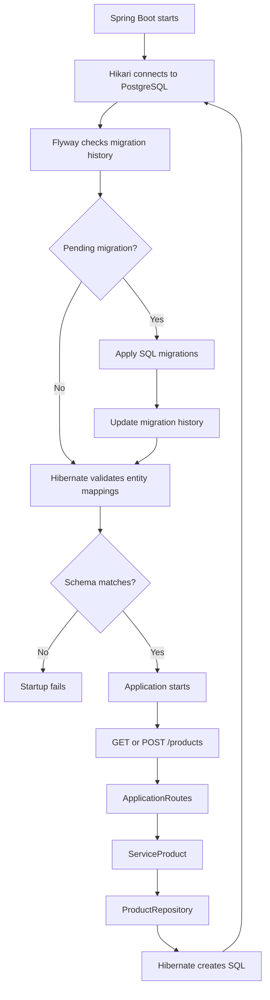

# Demo Spring Boot application

Inventory application using Java 25, Spring Boot 4.1.2, Spring Data JPA with Hibernate, PostgreSQL, and Flyway. The HTTP server listens on port `8022` by default.

## Development principle

Minimize Spring-specific magic and make behavior explicit wherever practical, including in tests. Prefer clear constructors, visible bean lookups and transaction boundaries, and JUnit lifecycle setup over hidden injection or framework-managed test behavior. Use Lombok to reduce routine boilerplate where it keeps the code clear. Use role-based names such as `ApplicationRoutes`, not business-domain names. Spring-managed JPA and Hibernate behavior remains part of the persistence stack.

## Local development

Install JDK 25 and ensure `JAVA_HOME` points to it. Start the development PostgreSQL instance on port `51214`, then use the included Maven wrapper:

```bash
cp -n .env.example .env
./mvnw spring-boot:run
```

Check the available endpoints:

```bash
curl -i http://localhost:8022/
curl -i http://localhost:8022/health
```

`GET /` returns the text `Application is running`. `GET /health` returns JSON:

```json
{"status":"ok"}
```

The health endpoint currently returns a fixed status; it does not check external dependencies.

Run tests or build an executable JAR:

```bash
./mvnw test
./mvnw package
java -jar target/demo-0.0.1-SNAPSHOT.jar
```

## Package structure

Application classes live under `src/main/java/com/example/demo` so Spring can discover components beneath the main application package.

| Package | Intended contents |
| --- | --- |
| `config` | Spring configuration and application settings bindings |
| `controller` | HTTP endpoints and request handling |
| `service` | Business logic and use cases |
| `repository` | Database access |
| `entity` | Persistent domain objects |
| `dto` | Request and response objects |
| `exception` | Application exceptions and shared HTTP exception handlers |
| `security` | Authentication and authorization configuration |

The `entity` package contains `Product`, `Location`, `InventoryBalance`, `StockMovement`, and `MovementType`. The `repository` package contains a `JpaRepository` for each entity. `ApplicationRoutes` lives in `controller` as the central route definition class. Other empty packages retain `.gitkeep` placeholders.

## Configuration

Application defaults are in `src/main/resources/application.properties`; local overrides are in `.env`. The port defaults to `8022` and the application name to `demo` when their environment values are absent.

Override the port in `.env` with `SERVER_PORT`:

```bash
SERVER_PORT=8080 ./mvnw spring-boot:run
```

`application.properties` imports the ignored local `.env` file. Copy `.env.example` to `.env` for development; set `SPRING_DATASOURCE_URL` to a JDBC URL, plus `SPRING_DATASOURCE_USERNAME` and `SPRING_DATASOURCE_PASSWORD`. The example uses `localhost:51214/template1`. The supplied Prisma URL is translated to JDBC syntax: `sslmode`, `connectTimeout`, and `socketTimeout` are URL parameters; pool size and timeouts are configured through Hikari. Environment variables can override these values. Redis auto-configuration remains disabled.

For this local Prisma dev database, `prepareThreshold=0` avoids server-side prepared-statement name collisions, and Flyway uses session-level advisory locks to avoid stalling across connections during migration.

Flyway applies versioned SQL files from `src/main/resources/db/migration` before Hibernate validates the schema (`ddl-auto: validate`). The initial migration matches the Fastify schema; the next migration renames its four tables to lowercase without dropping their data. The Fastify Prisma models map to those lowercase table names. Add a new migration for subsequent schema changes; do not edit an applied migration.

### Database lifecycle



When first adopting an existing Fastify database without Flyway history, inspect its schema, then run once with:

```bash
SPRING_FLYWAY_BASELINE_ON_MIGRATE=true SPRING_FLYWAY_BASELINE_VERSION=0 ./mvnw spring-boot:run
```

An empty database needs no baseline. Automatic baselining is disabled during normal startup.

Hibernate maintains creation and update timestamps for JPA writes. Balance and movement entities reference products and locations through lazy relationships. Inventory write operations should update balances and record movements in the same service transaction, with concurrency control; the repositories alone do not implement those business operations.

`./mvnw test` uses the configured PostgreSQL database, applies pending migrations, and checks persistence of all four entities and all movement types. Test inventory rows are rolled back; PostgreSQL sequences can still advance.

The test uses plain JUnit lifecycle hooks: `@BeforeEach` starts the application context, looks up dependencies with `context.getBean(...)`, and begins a transaction. `@AfterEach` rolls it back, confirms the test product was not committed, and closes the context even on failure. There is no Spring test autowiring or annotation-driven transaction setup.

The empty packages provide an organizational starting point. Add implementations as features require them; the directory layout alone does not provide production readiness.
